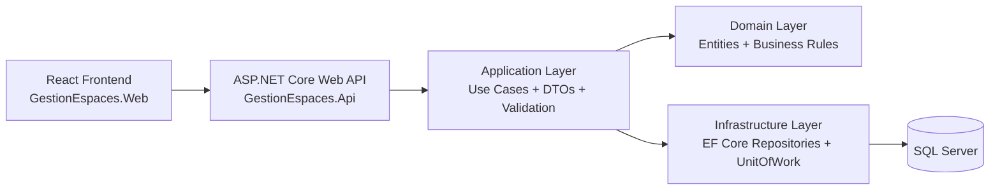

# GestionEspaces — Workspace Management Platform

Professional full-stack project for managing workspaces, people, and assets in an enterprise context.

**Stack:** ASP.NET Core · C# · React · SQL Server · Clean Architecture · JWT · Docker

---

## Project Description

GestionEspaces is a back-office application to manage:

- Sites and buildings
- Offices and office status
- Employees (agents)
- Assets (equipment)
- Office assignments (agent ↔ office)
- Asset assignments (agent ↔ asset)

It implements role-based access for **Administrator**, **Manager**, and **Agent** profiles.

---

## Key Features

- Clean Architecture backend (Domain / Application / Infrastructure / API)
- JWT authentication with role-based authorization (RBAC)
- Office and asset assignment workflows with history
- Optimistic concurrency with SQL Server `rowversion`
- Validation with FluentValidation
- Unit tests (xUnit) and integration tests (xUnit + Testcontainers)
- React back-office frontend with search and management screens
- Dockerized local SQL Server setup

---

## Architecture Overview



---

## Technology Stack

### Backend
- ASP.NET Core 10
- C#
- Entity Framework Core 10
- SQL Server
- FluentValidation
- Token-based authentication (JWT)

### Frontend
- React 19
- React Router 7
- Vite 8
- Tailwind CSS 4
- Axios

### Testing & DevOps
- xUnit
- Testcontainers
- Docker / Docker Compose
- GitHub Actions (CI)

---

## Database Model Overview

Core entities:

- `Site` 1..* `Batiment` 1..* `Bureau`
- `Agent` 1..* `AffectationPoste` *..1 `Bureau`
- `Agent` 1..* `AffectationActif` *..1 `Actif`

Highlights:

- Unique constraints on key business identifiers (e.g., site code, matricule, serial number, office number per building)
- `rowversion` concurrency tokens on main aggregates
- Assignment history through `DateAffectation` / `DateFin`

For full technical schema details, see:
- [`GestionEspaces/README.md`](GestionEspaces/README.md)

---

## Main Business Rules

- One agent can have **at most one active office assignment** at a time.
- One office can have **at most one active office assignment** at a time.
- One asset can have **at most one active asset assignment** at a time.
- Assignments can only be closed with a valid end date (`DateFin >= DateAffectation`).
- Offices in maintenance/out-of-service are not assignable.
- Out-of-service assets are not assignable.

---

## Installation & Run

### Prerequisites

- .NET SDK 10 (see `global.json`)
- Node.js 20+
- Docker Desktop

### 1) Clone and start database

```bash
git clone https://github.com/othman-gr3/gestion_des_espaces.git
cd gestion_des_espaces
docker compose up -d
```

### 2) Apply migrations and run backend

```bash
cd GestionEspaces
dotnet ef database update --project GestionEspaces.Infrastructure/GestionEspaces.Infrastructure.csproj --startup-project GestionEspaces.Api/GestionEspaces.Api.csproj
dotnet run --project GestionEspaces.Api/GestionEspaces.Api.csproj
```

Backend default URL: `http://localhost:5153` (Swagger: `/swagger`)

### 3) Run frontend

```bash
cd ../GestionEspaces.Web
npm install
npm run dev
```

Frontend default URL: `http://localhost:5173`

---

## Configuration

This project supports environment-based configuration.

1. Copy the example file:

```bash
cp .env.example .env
```

2. Update values for your local environment.

Important settings:

- `SA_PASSWORD` (used by Docker Compose for SQL Server)
- `VITE_API_URL` (frontend API base URL)
- `GestionEspaces__Jwt__SigningKey` (JWT signing key, 32+ random characters)

You can also set JWT key via user-secrets:

```bash
cd GestionEspaces/GestionEspaces.Api
dotnet user-secrets set "Jwt:SigningKey" "<your-random-32-plus-char-key>"
```

---

## Tests

From `GestionEspaces/`:

```bash
# Unit tests
dotnet test GestionEspaces.Tests/GestionEspaces.Tests.csproj

# Integration tests (requires Docker)
dotnet test GestionEspaces.IntegrationTests/GestionEspaces.IntegrationTests.csproj

# All tests
dotnet test GestionEspaces.slnx
```

---

## Demo Accounts (Placeholder Only)

> Passwords are intentionally not published in this README.
> Contact the repository owner for demo credentials, or create your own local seed values for development.

| Role | Email | Password |
|---|---|---|
| Administrator | `admin@onee.ma` | `<obtain from maintainer>` |
| Manager | `gestionnaire@onee.ma` | `<obtain from maintainer>` |
| Agent | `y.elamrani@onee.ma` | `<obtain from maintainer>` |

---

## Security Notes

- Never commit real secrets (`.env`, production keys, connection strings with real credentials).
- JWT signing key must be overridden for non-local usage.
- Access control is policy-based and role-scoped (Admin / Manager / Agent).
- Password storage uses hashed values (no plaintext credentials in production).

---

## CI/CD Notes

GitHub Actions workflow: `.github/workflows/ci.yml`

- **Backend job:** restore, build, unit tests
- **Frontend job:** install dependencies, production build
- Integration tests are kept separate due to SQL Server container/runtime cost

---

## Screenshots / Demo Video

> Add media links here when available.

- [ ] `docs/media/dashboard.png` (placeholder)
- [ ] `docs/media/assignments.png` (placeholder)
- [ ] `docs/media/agent-space.png` (placeholder)
- [ ] Demo video URL (placeholder)

---

## Repository Metadata (Recommended)

If repository settings are editable, use:

- **Description:** `Full-stack workspace and asset management platform with ASP.NET Core, React, JWT, and SQL Server.`
- **Topics:** `aspnet-core`, `csharp`, `react`, `clean-architecture`, `jwt`, `sql-server`, `docker`, `rest-api`, `testing`

---

## Additional Documentation

- Detailed backend technical reference: [`GestionEspaces/README.md`](GestionEspaces/README.md)
- Frontend quick README: [`GestionEspaces.Web/README.md`](GestionEspaces.Web/README.md)
